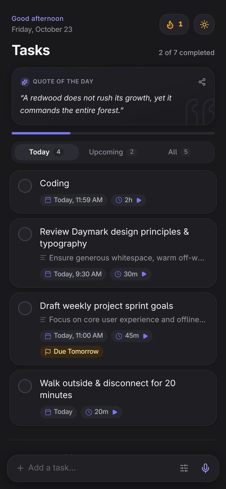
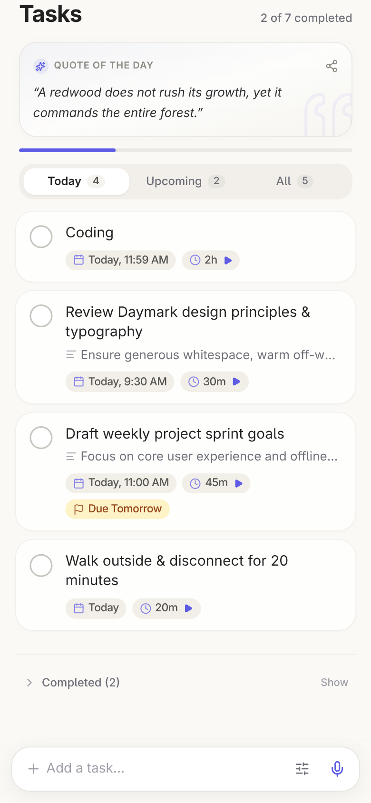
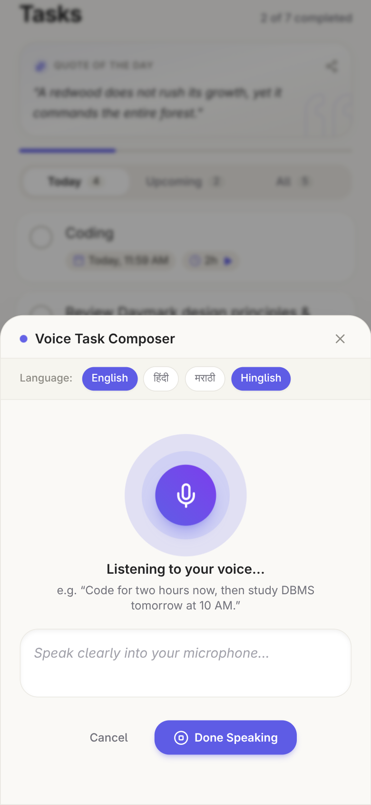
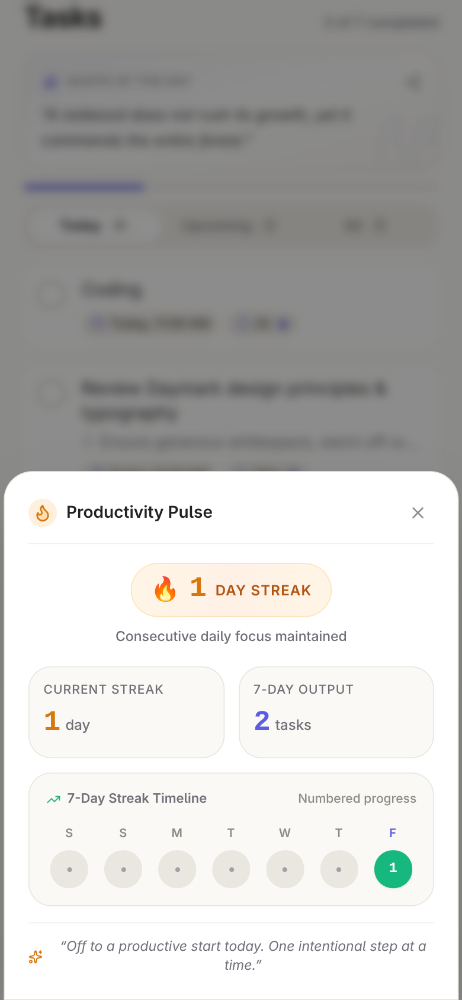
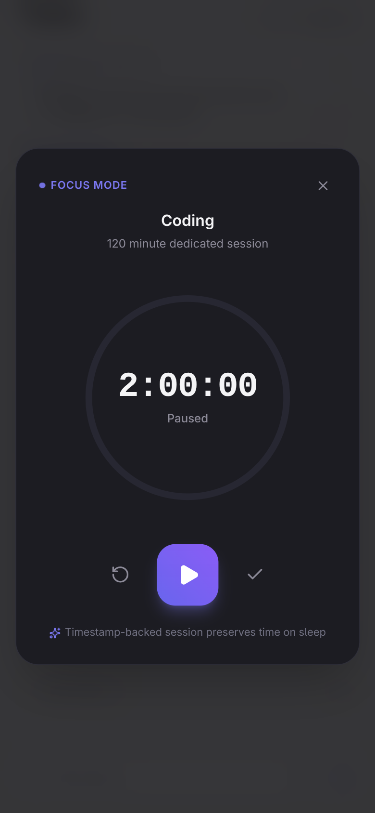
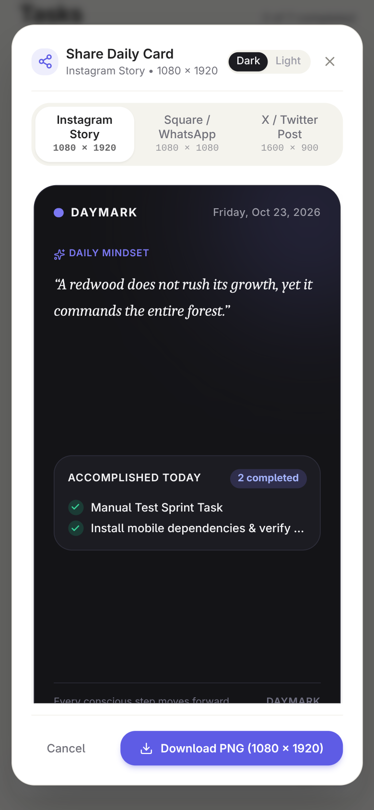

<p align="center">
  
</p>

<p align="center">
  <strong>Speak your plans. Own your day.</strong>
</p>

<p align="center">
  A voice-first, offline-ready daily task companion engineered with React 19, Capacitor, and Groq GPT-OSS 20B.
</p>

<p align="center">
  <a href="#-quick-tour--gallery">App Gallery</a> •
  <a href="#-why-daymark">Why Daymark</a> •
  <a href="#-features-at-a-glance">Features</a> •
  <a href="#-architecture--tech-stack">Tech Stack</a> •
  <a href="#-getting-started">Getting Started</a> •
  <a href="#-building-the-android-app">Android Build</a>
</p>

<p align="center">
  
  
  
  
  
  
</p>

---

## 💡 The Problem Daymark Solves

Traditional todo apps demand too much friction. When you have five thoughts in your head, opening an app, tapping through five date pickers, adjusting time sliders, and typing repetitive titles takes you out of your flow.

**Daymark re-engineers task capture around human speech:**
1. Speak a natural sentence: *"I'll do coding now for two hours, then study DBMS tomorrow at 10 AM, and finish my assignment by 6 PM."*
2. Daymark's backend (powered by Groq `openai/gpt-oss-20b`) processes your words in milliseconds, resolving relative dates, separate tasks, explicit durations, and deadlines.
3. Review and edit the proposed tasks in a clean modal before anything is saved.
4. Your tasks are stored in your **local SQLite database**—private, fast, and completely functional without an ongoing internet connection.

---

## 📱 Quick Tour & Gallery

All screenshots below are captured directly from the live running Daymark application.

| Dark Theme Task View | Light Theme Task View |
| :---: | :---: |
|  |  |
| *Editorial typography, daily quote, and progress bar* | *Warm off-white surfaces and accessible contrast* |

| Voice Task Composer | Numbered Streak & Productivity Pulse |
| :---: | :---: |
|  |  |
| *Multilingual speech recognition with English, Hindi & Marathi* | *Numbered streak markers tracking consecutive days completed* |

| Battery-Friendly Focus Mode | Social Progress Story Card |
| :---: | :---: |
|  |  |
| *Circular animated timer ring with sleep-proof delta timing* | *Exportable PNG in Story (9:16), Square (1:1), and Twitter (16:9)* |

---

## ✨ Features at a Glance

### 🎙️ Natural Voice-to-Task Decomposition
- **Single Sentence, Multiple Tasks**: Say *"Work on frontend for two hours, review PRs at 4 PM, and call mom tomorrow at 11 AM."* Daymark splits this into three discrete, accurately timed items.
- **Smart Time & Date Resolving**: Distinguishes start times (*"at 3 PM"*), durations (*"for 90 minutes"*), relative offsets (*"in two hours"*), and absolute deadlines (*"by Friday 5 PM"*).
- **Multilingual Support**: First-class support for English, Hindi (हिंदी), Marathi (मराठी), and conversational Hinglish.
- **Human-in-the-Loop**: Preview and edit AI-suggested titles, times, and tags before committing them to your schedule.

### 🔒 Local-First, Private by Design
- **Local SQLite Storage**: Powered by `@capacitor-community/sqlite` on mobile and resilient `localStorage` on web.
- **Zero Cloud Task Sync Required**: Your personal tasks never leave your device. Only speech transcripts are processed by the edge parser.
- **Full Offline Reliability**: Manage, complete, filter, and track tasks with zero internet connectivity.

### 🧘 Intentional Daily Workflow
- **Quote of the Day**: Curated philosophical, stoic, and growth-oriented reflections refreshed daily.
- **Productivity Pulse & Numbered Streak**: A GitHub/LeetCode-style 7-day timeline displaying the exact consecutive day number inside each active completion marker.
- **Focus Mode**: A distraction-free countdown timer that calculates elapsed time via timestamp deltas (`Date.now() - sessionStart`), staying accurate even when your phone locks or sleeps.
- **Subtle Haptics**: Native vibration pulses using `@capacitor/haptics` for task check-off and voice confirmation, with graceful web fallbacks.
- **Shareable Daily Story Cards**: Generate crisp 1080×1920 (Instagram Story), 1080×1080 (Square / WhatsApp), or 1600×900 (X / Twitter) editorial graphic cards to celebrate daily consistency.

### 📱 Android Home-Screen Widget
- **Today's Glanceable Snapshot**: Displays your daily tasks and completion progress directly on your Android home screen.
- **One-Tap Completion**: Check off tasks directly from the home screen; updates the widget immediately and syncs with SQLite.
- **Instant Voice Capture**: Microphone shortcut launches Daymark straight into the listening voice composer.

---

## 🛠️ Architecture & Tech Stack

```
daymark/
├── android/                   # Native Android Capacitor wrapper
│   ├── app/src/main/res/      # AppWidget XML layouts & drawables
│   └── app/src/main/java/     # DaymarkWidgetProvider.java & MainActivity.java
├── src/
│   ├── react-app/             # Frontend UI (React 19 + TypeScript + Vite)
│   │   ├── components/        # Modals (Voice, Pulse, Focus, ShareCard, Tasks)
│   │   ├── hooks/             # useTasks, useVoiceTaskFlow, useTheme
│   │   ├── storage/           # SQLite repository & widgetSync bridge
│   │   └── lib/               # Haptics, pulseUtils, dateUtils
│   ├── shared/                # Shared task schemas and Zod validators
│   └── worker/                # Edge API & Groq LLM parser (Hono)
└── tests/                     # Master test suite & feature verification
```

### Core Technologies

- **Frontend**: [React 19](https://react.dev/), [TypeScript 5.9](https://www.typescriptlang.org/), [Vite](https://vitejs.dev/)
- **Styling**: [Tailwind CSS v4](https://tailwindcss.com/) with custom dark charcoal and warm off-white tokens
- **Animations**: [Motion](https://motion.dev/)
- **Mobile Runtime**: [Capacitor 8](https://capacitorjs.com/) with native SQLite, Haptics, Local Notifications, and Share plugins
- **Backend / Edge**: [Hono 4](https://hono.dev/) on Cloudflare Workers
- **AI Intelligence**: [Groq](https://groq.com/) running `openai/gpt-oss-20b` for ultra-low-latency structured JSON extraction

---

## 🔍 Technical Deep Dives

<details>
<summary><strong>🎙️ How Voice-to-Task Processing Works</strong></summary>
<br />

When you record a voice prompt:
1. Speech is transcribed on-device via `@capgo/capacitor-speech-recognition` (or browser SpeechRecognition).
2. The transcript is sent to the backend Hono route (`POST /api/parse-task`) along with the user's local reference date and timezone.
3. The server crafts a system prompt embedding ISO calendar constraints and sends it to Groq's high-speed inference engine running `openai/gpt-oss-20b`.
4. The output is strictly parsed and validated using a Zod schema (`TaskDecompositionResponseSchema`), ensuring all relative references (e.g. *"tomorrow at 10 AM"*) resolve to valid dates.
5. Structured proposals are returned to the frontend where the user reviews them before persisting to SQLite.

</details>

<details>
<summary><strong>💾 Local Storage & Android Widget Synchronization</strong></summary>
<br />

Daymark operates on a local-first philosophy:
- **Primary Database**: Tasks are saved into a SQLite database (`daymark_tasks.db`) through `@capacitor-community/sqlite`.
- **Widget Bridge**: Whenever tasks are created, modified, completed, or deleted, `widgetSync.ts` updates a cached JSON snapshot (`daymark_widget_snapshot`) in Android's `CapacitorStorage` SharedPreferences and immediately triggers `DaymarkWidgetProvider.updateAllWidgets(context)`.
- **Interactive Completion**: Tapping a task checkmark on the Android home-screen widget updates RemoteViews immediately and records the task ID in `pending_widget_toggles`. When Daymark resumes, it automatically reconciles the changes with the SQLite database.

</details>

<details>
<summary><strong>🔐 Security & API Key Isolation</strong></summary>
<br />

- Your **Groq API Key never touches the client application or Android APK bundle**.
- The Groq key is stored exclusively as an environment secret in the edge worker (`.dev.vars` locally or Cloudflare Secrets in production).
- The mobile application only communicates with your backend endpoint (`/api/parse-task`), keeping keys secure from decompilation.

</details>

---

## 🚀 Getting Started

### Prerequisites

- [Node.js](https://nodejs.org/) (v20 or v22 LTS recommended)
- `npm` (v10+)
- A [Groq API Key](https://console.groq.com/keys) (free tier works great)

### 1. Clone the Repository

```bash
git clone https://github.com/Pruthviraj141/Tasks.git
cd Tasks
```

### 2. Install Dependencies

```bash
npm install
```

### 3. Configure Environment Variables

Create `.dev.vars` in the project root:

```bash
cp .env.example .dev.vars
```

Add your Groq API key:

```ini
GROQ_API_KEY="your_groq_api_key_here"
```

### 4. Run Locally

Start the full-stack development environment (Vite frontend + Hono edge API):

```bash
npm run dev
```

Open [http://localhost:5173](http://localhost:5173) in your browser.

---

## 🧪 Running Tests

Daymark includes automated test coverage validating Zod schemas, date math, Groq parsing accuracy, streak calculations, and Android widget layouts:

```bash
# Run Master Phase 2 Test Suite (27 test cases including live Groq parsing)
npm test

# Run Feature Refinement Verification Suite (Streak, 3-Format Share, Widget)
npx tsx tests/final_refinements.test.ts

# Run ESLint & TypeScript build check
npm run lint && npm run build
```

---

## 📱 Building the Android App

> [!NOTE]
> Pre-compiled APK binaries are not currently hosted in GitHub Releases. You can easily build the Android package locally using standard Capacitor tooling:

<details>
<summary><strong>Click to view Android Build Steps</strong></summary>
<br />

### Prerequisites for Android
- [Android Studio](https://developer.android.com/studio) installed with Android SDK (API 34+) and Java 17/21.

### 1. Build the Production Bundle
```bash
npm run build
```

### 2. Synchronize Web Assets with Android Project
```bash
npx cap sync android
```

### 3. Open in Android Studio or Build APK Directly
Open Android Studio:
```bash
npx cap open android
```

Or build a debug APK from the command line:
```bash
cd android
./gradlew assembleDebug
```

The resulting APK will be generated at:
```text
android/app/build/outputs/apk/debug/app-debug.apk
```

</details>

---

## 📄 License

This project is licensed under the [MIT License](LICENSE).
