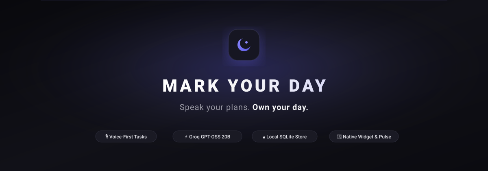
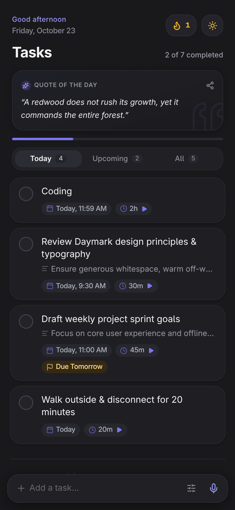
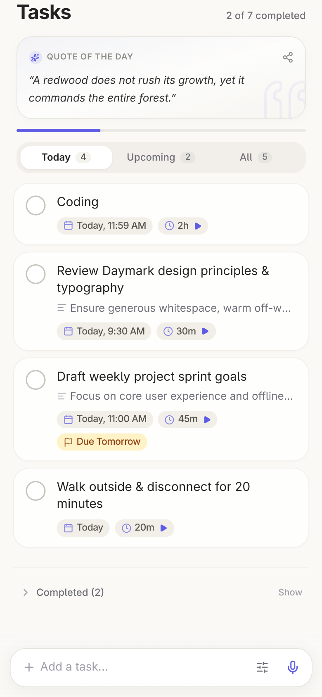
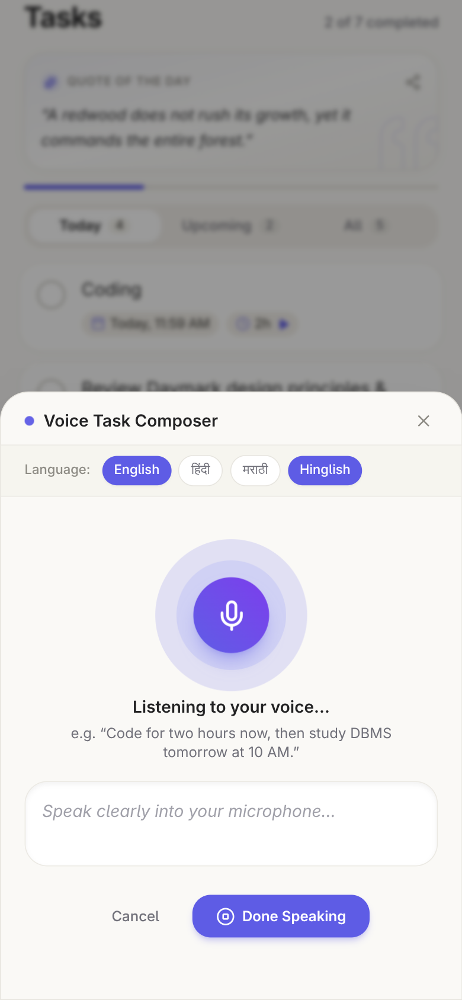
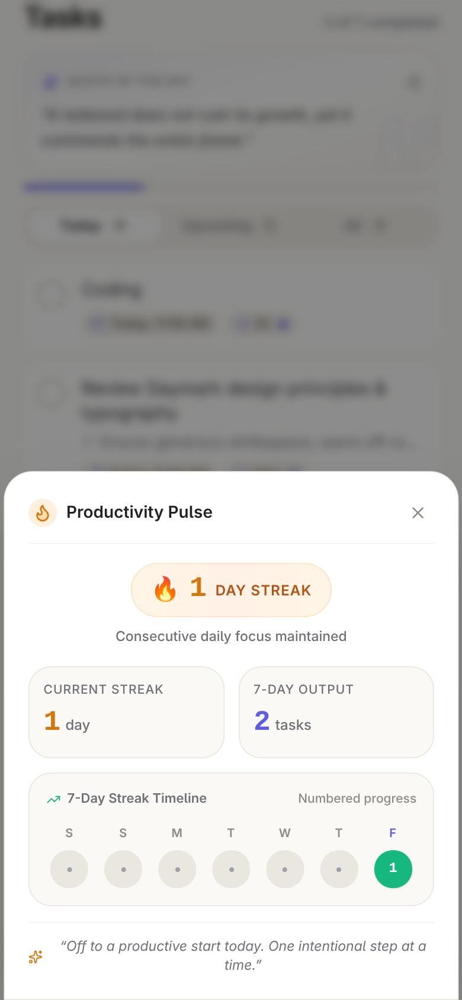
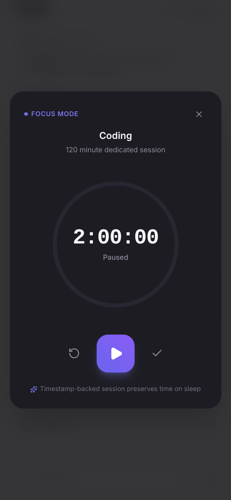
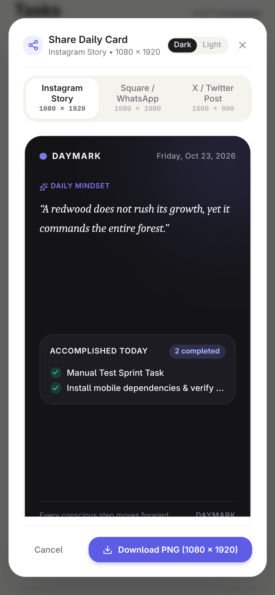

<p align="center">
  
</p>

<p align="center">
  <strong>Speak your plans. Own your day.</strong>
</p>

<p align="center">
  A voice-first, offline-ready daily task companion engineered with React 19, Capacitor, and Groq GPT-OSS 20B.
</p>

<p align="center">
  <a href="https://daymark.markyourday.workers.dev">
    
  </a>
  &nbsp;
  <a href="https://github.com/Pruthviraj141/Tasks/releases/download/v1.0.0/MarkMyDay.apk">
    
  </a>
  &nbsp;
  <a href="https://github.com/Pruthviraj141/Tasks/releases">
    
  </a>
</p>

<p align="center">
  <a href="#-links--quick-access">Links</a> •
  <a href="#-why-markyourday-why-not-just-google-tasks-or-random-play-store-apps">Why MarkYourDay</a> •
  <a href="#-features-built-for-speed-zero-fluff">Features</a> •
  <a href="#-quick-tour--gallery">App Gallery</a> •
  <a href="#-architecture--tech-stack">Tech Stack</a> •
  <a href="#-getting-started">Getting Started</a> •
  <a href="#-building-the-android-app">Android Build</a>
</p>

<p align="center">
  
  
  
  
  
  
  
</p>

---

## 🔗 Links & Quick Access

| Platform / Artifact | Link | Details |
| :--- | :--- | :--- |
| **🌐 Production Web App** | [daymark.markyourday.workers.dev](https://daymark.markyourday.workers.dev) | Instant PWA / web client running on Cloudflare Edge |
| **📱 Direct Android APK** | [Download MarkMyDay.apk (v1.0.0)](https://github.com/Pruthviraj141/Tasks/releases/download/v1.0.0/MarkMyDay.apk) | Standalone release bundle for all modern Android devices |
| **📦 GitHub Releases** | [github.com/Pruthviraj141/Tasks/releases](https://github.com/Pruthviraj141/Tasks/releases) | Release notes, asset checksums, and version history |

---

## 💡 Why MarkYourDay? (Why Not Just Google Tasks or Random Play Store Apps?)

Let's be completely honest: **typing your daily tasks on a tiny mobile keyboard is where productive momentum goes to die.**

You're walking, driving, commuting between meetings, or your brain is buzzing with 4 different priorities. You open traditional task apps:
- You tap `+`. You type the task title with your thumbs.
- You tap the calendar icon. You scroll the date wheel.
- You tap time. You scroll the hour wheel, then the minute wheel.
- You tap Save.
- *...And now you have to repeat that entire circus 3 more times for your other thoughts.*

By the second task, you've completely lost your flow, got sidetracked by a notification, and put your phone down.

And what about the typical apps on the app store?
They hit you with mandatory account signups, pop-up ads for mobile games, or slap a **$4.99/month subscription paywall** on basic essentials like recurring tasks, dark mode, or widgets. To top it off, your personal daily routine gets uploaded to big-tech cloud servers to fuel targeted ad profiles.

**MarkYourDay was built to kill that friction entirely.** One breath. Zero typing. Zero subscriptions. Zero cloud surveillance.

### 🥊 Google Tasks / Play Store vs. MarkYourDay

| Friction Point | Traditional Apps (Google Tasks, Todoist, Play Store) 🥱 | MarkYourDay ⚡ |
| :--- | :--- | :--- |
| **Input Speed** | 10+ taps, typing on keyboard, fidgeting with date pickers | **Hold mic, speak naturally for 5 seconds.** Handled. |
| **Multi-Task Brain Dump** | Must create tasks one by painful one | **Decomposes 3-4 tasks from a single breath** in ~400ms via Groq LLM |
| **Privacy & Cloud Sync** | Required Google/Apple login; stored on big-tech cloud servers | **100% local SQLite database.** Your schedule never leaves your device |
| **Offline Reliability** | Spinners, sync errors, or blank screens without Wi-Fi | **Instant, zero-latency local-first.** Works in an airplane or subway |
| **Pricing & Monetization** | Ads, "Pro" subscriptions ($48/yr), paywalled widgets | **100% free, MIT open-source, zero paywalls forever** |
| **Focus Mode** | Basic timers that pause or drift when your screen locks | **Sleep-proof delta timer with persistent Android status bar notification** |
| **Home Screen Action** | Static lists or clunky web views | **Interactive native Android widget with 1-tap check-off & instant mic** |
| **Social Progress** | Manual screenshots or no sharing | **Export high-res story cards directly to Instagram & X in White/Dark modes** |

---

## ⚡ Features Built for Speed, Zero Fluff

Every single feature in MarkYourDay was engineered around one rule: **maximum execution, zero friction.**

### 🎙️ 1. Multi-Task Voice Brain-Dump (Groq GPT-OSS 20B)
Speak naturally without robot syntax: *"Gym at 6 PM, review the pull requests for two hours, and call mom tomorrow morning at 10."* Powered by **Groq's edge inference running `openai/gpt-oss-20b`**, MarkYourDay parses your voice in sub-second speed (~400ms), resolves start times, durations, and deadlines into separate structured cards, and lets you tap once to confirm and save all tasks simultaneously. Supports **English, Hindi (हिंदी), Marathi (मराठी)**, and conversational Hinglish.

### 🔒 2. Zero-Latency, 100% Local-First SQLite & Private Cloud Backup
Zero wait times. On Android, MarkYourDay writes directly to native SQLite via `@capacitor-community/sqlite`. When signed in, background cloud sync merges non-destructively so your local additions and completions always display with 0ms latency.

### ⏱️ 3. Sleep-Proof Focus Mode with Persistent Status Bar Notification
Timers that reset when your screen turns off are useless. MarkYourDay's Focus Mode uses hardware timestamp-delta calculations (`Date.now() - sessionStart`). While running, an **ongoing notification sits in your Android status bar and lock screen** showing live countdown ticks (`⏱️ 24:35 • Focusing: Task Name`). You can lock your phone and put it in your pocket; tapping the notification outside the app brings you right back into the active session.

### 📱 4. Interactive Android Home-Screen Widget
Never open the app just to tick a box. The native Android widget displays today's live tasks right on your home screen. Tap any task checkbox to complete it on the spot (syncs directly with local SQLite). Need to capture a thought? Tap the widget's mic icon to launch straight into voice capture.

### 📸 5. Editorial Social Story Cards (Instagram & X Ready)
Built-in proof of work. Turn today's completed tasks into clean, aesthetic graphic cards with one click.
- **Multiple Formats**: Story 9:16 (Instagram / Stories), Square 1:1 (Feed / Threads), and Landscape 16:9 (X / Twitter).
- **Dual Themes**: Crisp White Mode with high-contrast `#09090B` typography or sleek `#09090D` OLED dark mode.
- **Native File Sharing**: Integrates directly with Android's system share tray to post images to Instagram, WhatsApp, Telegram, or X with a single tap.

### 🔥 6. GitHub-Style Numbered Streak & 7-Day Pulse
Real consistency, no fake dopamine. The Pulse dashboard tracks consecutive days where you *actually completed* at least one task. Features an animated flame badge (`🔥 7`) and a 7-day visual milestone track where your consecutive streak number is embedded directly inside active completion markers.

### 🌓 7. Dual Themes: Crisp White Mode & Midnight Charcoal
No blinding white screens, and no lazy pure-black backgrounds that cause eye strain. MarkYourDay features a custom-tuned charcoal dark mode designed specifically for contrast and OLED battery saving, paired with a warm editorial off-white paper light theme with deep dark black fonts.

### 📜 8. Daily Stoic Spark
Every midnight, MarkYourDay quietly updates with a curated philosophical or stoic insight (Marcus Aurelius, Seneca, Naval) to keep you grounded before you start executing. Zero cringe hustle bro quotes.

---

## 📱 Quick Tour & Gallery

Every screenshot below is captured directly from the live running MarkYourDay application:

| Dark Theme Task View | Light Theme Task View |
| :---: | :---: |
|  |  |
| *Editorial typography, daily quote, and progress bar* | *Warm off-white surfaces and accessible contrast* |

| Voice Task Composer | Numbered Streak & Productivity Pulse |
| :---: | :---: |
|  |  |
| *Multilingual speech recognition with English, Hindi & Marathi* | *Numbered streak markers tracking consecutive days completed* |

| Battery-Friendly Focus Mode | Social Progress Story Card |
| :---: | :---: |
|  |  |
| *Circular animated timer ring with sleep-proof delta timing* | *Exportable PNG in Story (9:16), Square (1:1), and Twitter (16:9)* |

---

## 🛠️ Architecture & Tech Stack

```
markyourday/
├── android/                   # Native Android Capacitor wrapper
│   ├── app/src/main/res/      # AppWidget XML layouts & drawables
│   └── app/src/main/java/     # AppWidgetProvider & MainActivity.java
├── src/
│   ├── react-app/             # Frontend UI (React 19 + TypeScript + Vite)
│   │   ├── components/        # Modals (Voice, Pulse, Focus, ShareCard, Tasks)
│   │   ├── hooks/             # useTasks, useVoiceTaskFlow, useTheme
│   │   ├── storage/           # SQLite repository, Supabase cloud sync, widgetSync
│   │   └── lib/               # Haptics, pulseUtils, dateUtils
│   ├── shared/                # Shared task schemas and Zod validators
│   └── worker/                # Edge API & Groq LLM parser (Hono on Cloudflare)
└── tests/                     # Master test suite & feature verification
```

### Core Technologies

- **Frontend**: [React 19](https://react.dev/), [TypeScript 5.9](https://www.typescriptlang.org/), [Vite](https://vitejs.dev/)
- **Styling**: [Tailwind CSS v4](https://tailwindcss.com/) with custom dark charcoal and warm off-white tokens
- **Animations**: [Motion](https://motion.dev/)
- **Mobile Runtime**: [Capacitor 8](https://capacitorjs.com/) with native SQLite, Haptics, Local Notifications, Filesystem, and Share plugins
- **Backend / Edge**: [Hono 4](https://hono.dev/) on Cloudflare Workers
- **AI Intelligence**: [Groq](https://groq.com/) running `openai/gpt-oss-20b` for ultra-low-latency structured JSON extraction

---

## 🚀 Getting Started

### Prerequisites

- [Node.js](https://nodejs.org/) (v20 or v22 LTS recommended)
- `npm` (v10+)
- A [Groq API Key](https://console.groq.com/keys) (free tier works great)

### 1. Clone the Repository

```bash
git clone https://github.com/Pruthviraj141/Tasks.git
cd Tasks
```

### 2. Install Dependencies

```bash
npm install
```

### 3. Configure Environment Variables

Create `.dev.vars` in the project root:

```bash
cp .env.example .dev.vars
```

Add your Groq API key:

```ini
GROQ_API_KEY="your_groq_api_key_here"
```

### 4. Run Locally

Start the full-stack development environment (Vite frontend + Hono edge API):

```bash
npm run dev
```

Open [http://localhost:5173](http://localhost:5173) in your browser.

---

## 📱 Building the Android App

You can directly download the pre-compiled APK from [GitHub Releases](https://github.com/Pruthviraj141/Tasks/releases/download/v1.0.0/MarkMyDay.apk) or compile it yourself locally:

<details>
<summary><strong>Click to view Android Build Steps</strong></summary>
<br />

### Prerequisites for Android
- [Android Studio](https://developer.android.com/studio) installed with Android SDK (API 34+) and Java 17/21.

### 1. Build the Production Bundle
```bash
npm run build
```

### 2. Synchronize Web Assets with Android Project
```bash
npx cap sync android
```

### 3. Open in Android Studio or Build APK Directly
Open Android Studio:
```bash
npx cap open android
```

Or build a debug APK from the command line:
```bash
cd android
./gradlew assembleDebug
```

The resulting APK will be generated at:
```text
android/app/build/outputs/apk/debug/MarkYourDay-debug.apk
```

</details>

---

## 🧪 Running Tests

MarkYourDay includes automated test coverage validating Zod schemas, date math, Groq parsing accuracy, streak calculations, and Android widget layouts:

```bash
# Run Master Test Suite
npm test

# Run ESLint & TypeScript build check
npm run lint && npm run build
```

---

## 📄 License

This project is licensed under the [MIT License](LICENSE).
